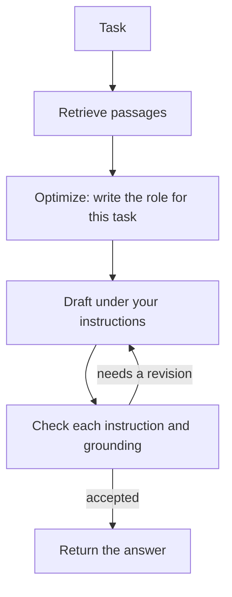

<h1 align="center">loop-kit</h1>

<p align="center">
  Answers from your documents, checked against your instructions.<br>
  A draft, check, and revise loop that code controls, not the model.
</p>

<p align="center">
  <a href="https://github.com/OWNER/loop-kit/actions/workflows/ci.yml"></a>
  <a href="https://pypi.org/project/loop-kit/"></a>
  
  
  <a href="LICENSE"></a>
</p>

---

loop-kit answers from your documents. You give it a knowledge base and, when you want to, instructions. It retrieves the relevant passages and runs a draft, check, and revise loop until the answer follows those instructions and stays inside the documents.

The model does not own the loop. Code does. loop-kit is a library. A program keeps a `Loop` and calls `ask`.

```python
from loopkit import Loop

loop = Loop(knowledge="knowledge")
print(loop.ask("What is the refund window?"))
```

## Contents

- [Why loop-kit](#why-loop-kit)
- [Install](#install)
- [Quickstart](#quickstart)
- [The loop](#the-loop)
- [Configuration](#configuration)
  - [Providers](#providers)
  - [Defaults](#defaults)
  - [Instructions](#instructions)
  - [Knowledge](#knowledge)
  - [Project file](#project-file)
- [Use the answer](#use-the-answer)
- [Command line](#command-line)
- [What the model is allowed to do](#what-the-model-is-allowed-to-do)
- [Example](#example)
- [Status](#status)
- [Develop](#develop)
- [Contributing](#contributing)
- [Citation](#citation)
- [License](#license)

## Why loop-kit

You point a model at your docs and it answers beautifully, and some of it is made up. You add "only answer from the documents" and "keep it under 80 words" to the prompt, and it follows them most of the time, which is the same as not following them. So you reach for the usual stack: an embedding model, a vector database, an agent framework, and a growing prompt nobody wants to touch. Weeks later the answers are still confident, still occasionally wrong, and now you cannot tell why.

loop-kit takes the opposite bet. Keep the model on a short leash and let code do the looping. The model drafts an answer and cites the passages it used. Then it is checked, one instruction at a time, so a miss cannot hide in a long list, and once more for grounding: did it stay inside the passages, are the citations real. If anything fails, the next draft is told exactly what to fix. If everything passes, you get the answer and the audit trail that proves it. Three turns, then it stops. There is no vector database to run, no embedding model to pick, no graph to debug. There is a folder of documents, a list of rules, and a loop you can read in one file.

## Install

```bash
pip install loop-kit            # OpenAI, Anthropic, and OpenAI-compatible servers
pip install "loop-kit[xai]"     # adds the xAI SDK for Grok
```

Requires Python 3.11 or newer. The PyPI project named `loopkit` (no hyphen) is unrelated control-systems software. This project is `loop-kit`.

To install from a checkout instead: `pip install -e .` (or `-e ".[xai]"`).

## Quickstart

Set one API key in the environment. If only one of these is set, that provider is used:

```bash
export XAI_API_KEY="your_api_key"
# or: export OPENAI_API_KEY="your_api_key"
# or: export ANTHROPIC_API_KEY="your_api_key"
```

Point a `Loop` at a folder of documents and ask:

```python
from loopkit import Loop

loop = Loop(
    knowledge="docs/",
    instructions=[
        "You are the Sample Co support assistant.",
        "Answer in under 80 words.",
    ],
)
answer = loop.ask("What is the refund window?")
print(answer)                 # the text
print(answer.citations)       # the passages it used
print(answer.stopped_reason)  # "passed" or "max_turns"
```

Or try it from the terminal without writing a script:

```bash
loopkit init                              # writes loopkit.toml and knowledge/start.md
loopkit ask "What is the refund window?"  # prints each loop step to stderr, the answer to stdout
```

From a checkout, `make` does the setup for you. The first call creates `.venv/` and installs everything; later calls reuse it:

```bash
cp .env.example .env                      # put one API key in it; .env is gitignored
make init                                 # or: make example
make ask Q="What is the refund window?"
make serve                                # http://127.0.0.1:8080
```

Keys are read from the environment, or from `api_key=`. Do not commit them.

## The loop



The optimize step is one call that writes who the model should be for this task (see [Auto-optimize](#auto-optimize)); that role prefixes every call after it. The drafter writes an answer and cites passage ids. By default the checker then judges one instruction per call, so a long list is not scored all at once, and finishes with one grounding check. The loop stops when every instruction holds, the draft stays inside the passages, citations are real ids, and the checker does not ask for another pass. Otherwise it revises, up to 3 turns, and the next draft is told which instructions failed. `check_mode="all"` is the two-call turn: one draft, then one check that scores every instruction together.

This is what `loopkit ask` prints while it runs (stderr), for the [example](#example) knowledge base with five instructions, when the first draft misses one:

```text
loopkit: 4 passages loaded, 4 sent to the model
loopkit: turn 1: draft
loopkit: turn 1: check instruction 1
loopkit: turn 1: check instruction 2
loopkit: turn 1: check instruction 3
loopkit: turn 1: check instruction 4
loopkit: turn 1: check instruction 5
loopkit: turn 1: check grounding
loopkit: instructions not followed: 2
loopkit: revise
loopkit: turn 2: draft
loopkit: turn 2: check instruction 1
loopkit: turn 2: check instruction 2
loopkit: turn 2: check instruction 3
loopkit: turn 2: check instruction 4
loopkit: turn 2: check instruction 5
loopkit: turn 2: check grounding
loopkit: stop: passed
Yes. Northwind refunds a subscription cancelled within 14 days of the charge, so a charge from 10 days ago qualifies. The refund returns to the original payment method within 5 business days. [p1]
```

You bring documents and instructions. Chunking, retrieval, prompts, the checker, citation checks, and the stop condition ship in this repo. The loop itself is [`src/loopkit/loop.py`](src/loopkit/loop.py).

## Configuration

### Providers

| Provider | Environment variable | Default model | Transport |
| --- | --- | --- | --- |
| xAI | `XAI_API_KEY` | `grok-4.7` | [xAI SDK](https://docs.x.ai/developers/quickstart), via the `xai` extra |
| OpenAI | `OPENAI_API_KEY` | `gpt-6.1-sol` | Responses API, standard library only |
| Anthropic | `ANTHROPIC_API_KEY` | `claude-sonnet-5-5` | Messages API, standard library only |
| OpenAI-compatible | `LOOPKIT_API_KEY`, or `OPENAI_API_KEY`; none for a local URL | none; pass `model` | Chat completions, standard library only |

If more than one key is set, pass `provider` or set `LOOPKIT_PROVIDER` to `xai`, `openai`, or `anthropic`. Another OpenAI-compatible server needs `base_url` and `model`:

```python
Loop(knowledge="knowledge", base_url="http://localhost:11434/v1", model="llama3.1")
```

Environment variables, all optional:

| Variable | Effect |
| --- | --- |
| `LOOPKIT_PROVIDER` | Chooses the provider when more than one key is set |
| `LOOPKIT_MODEL` | Overrides the model without code changes |
| `LOOPKIT_BASE_URL` | Same as `base_url=`; implies the OpenAI-compatible provider |
| `LOOPKIT_API_KEY` | Key for an OpenAI-compatible server. Falls back to `OPENAI_API_KEY`; `localhost` URLs need neither |
| `LOOPKIT_TRACE` | `1` prints each loop step to stderr (`loopkit ask` does this by default) |

### Defaults

| | |
| --- | --- |
| Provider | The one API key that is set. `provider` or `LOOPKIT_PROVIDER` chooses when several are set |
| Model | That provider's default, unless you pass `model` or set `LOOPKIT_MODEL` |
| Instructions | With passages, four separate rules: answer only from the passages, cite ids, say when the answer is missing, and stay concise. With no passages (open mode), three: answer from your own knowledge, flag uncertain specifics, stay concise |
| Check | `each`: one model call per instruction, then grounding. `all`: every instruction in one call |
| Response | `normal`. `book` asks for a long response and raises the output cap to 100,000 tokens |
| Turns | 3 |
| Retrieval | The whole knowledge base under about 16,000 characters; otherwise a local RAG query (BM25), top 8 passages |
| Search | Off. `search=True` lets the model use the provider's web search in the draft and the audit |
| Auto-optimize | On. One call before the loop writes a role for the task that prefixes every draft and check. `auto_optimize=False` skips it |
| Stored prompts | Off for xAI and OpenAI. The request is still sent to the provider you configured |

### Instructions

Instructions are a list. The checker judges each one on its own. The loop revises until every item holds, or the turn budget runs out. A miss is named in the notes for the next draft.

Pass them when the built-in policy is not the one you want:

```python
loop = Loop(
    knowledge="knowledge",
    instructions=[
        "You are the Sample Co support assistant.",
        "Answer in under 80 words.",
    ],
)
```

A string is split into one instruction per non-empty line, which is how an instructions file is read. A list is used as given: each item is one instruction, and line breaks inside an item stay part of that instruction. `loop.instructions` is always the tuple the checker validates.

`check_mode="each"` validates those items one call at a time. `check_mode="all"` sends the whole list to one check. `response="book"` asks for a long-form answer with headings, instead of the concise default, and raises the output cap on the built-in clients. `response="normal"` is the direct answer.

Or put the list in `loopkit.toml` and leave it out of code:

```toml
knowledge = "knowledge"
instructions = [
  "You are the Sample Co support assistant.",
  "Answer in under 80 words.",
]
```

The same `Loop` is what the terminal command calls. `loopkit ask` is a way to try a project without writing a script. It prints each step to stderr. `--quiet` prints the answer only. `--json` prints the answer object.

```bash
loopkit ask "Can I get a refund?"
```

The task can also come from a file or from stdin, which sidesteps shell quoting:

```bash
loopkit ask --task-file question.txt
echo 'What does `ls -la` do?' | loopkit ask
cat question.md | loopkit ask -
```

Backticks are the usual trap. In bash and zsh, `` `ls` `` inside double quotes runs `ls` and pastes its output into the task; use single quotes, or `\``. In PowerShell the backtick is the escape character; write ``` `` ``` for a literal one, or use `--task-file`. None of this is loop-kit: the task is sent to the model exactly as the shell hands it over.

## Auto-optimize

On by default. Before the first draft, one extra model call reads the task, your instructions, and (with a knowledge base) the list of document names and headings, and writes a **role**: two to four sentences, second person, starting with "You are", naming the field, the sub-speciality, and the working habits that fit this particular task. That role is prefixed to the system prompt of every call that follows in that `ask`: the draft, each instruction check, and the grounding or accuracy audit. The optimizer is told not to answer the task and not to add rules about format, length, or sources; your numbered instructions still take precedence.

The point is that the model that answers, and the model that checks the answer, both work as the right specialist rather than as a generic assistant. The same `Loop` gets a different role for each task.

What it produces, by example:

| Task | Role the optimize step writes (illustrative) |
| --- | --- |
| *Explain Dhammapada verse 1 and the story attached to it* (no knowledge base) | You are a scholar of early Buddhist literature with a specialism in the Pali Dhammapada and its commentary. You separate what the verse says from what the later commentarial story adds, you mark translations as your own or name the translator, and you explain Pali terms on first use for a general reader. |
| *Can I get a refund? I was charged 10 days ago* (Northwind knowledge base) | You are a Northwind billing support specialist who knows the company's refund and plan policies from its own documentation. You answer with the exact window and conditions, and you say plainly when a case falls outside them. |
| *How do I rotate an API key?* (Northwind knowledge base) | You are a Northwind account-security support engineer who knows its API key lifecycle. You give steps in the order a user would perform them and you call out what cannot be undone. |

The role is returned as `answer.role` and in `--json`, printed as a `role:` trace line by `loopkit ask`, and written to the debug log as `CALL 1: optimize` with the full prompt and reply, then under `ROLE` in the `ANSWER` block. If the optimize call fails, a warning is logged and the loop continues with no role; a quality step does not by itself stop an answer.

Today the role is generated from the task, the instructions, and the document list. Later versions can feed it more context. Turn it off when you supply your own persona in the instructions and do not want a second one, or to save the call:

```python
Loop(knowledge="knowledge", auto_optimize=False)
```

```bash
loopkit ask "Can I get a refund?" --no-auto-optimize
LOOPKIT_AUTO_OPTIMIZE=0 loopkit ask ...
```

or `auto_optimize = false` in `loopkit.toml`. With it on, a default `ask` is 7 model calls per turn at most on the first turn (optimize, draft, 4 instruction checks, grounding), then 6 per revision turn; `check_mode="all"` makes that 3 then 2.

## Use the answer

```python
answer = loop.ask("What is the refund window?")
answer.text
answer.citations   # passages the draft cited
answer.role        # the role the optimize step wrote for this task, "" when off
answer.response    # "normal" or "book"
answer.checks      # one auditor result per turn, with a verdict for each instruction
answer.turns
answer.stopped_reason  # "passed" or "max_turns"
```

`str(answer)` is the text. Build the `Loop` once and call `ask` for each task. Documents are read at construction.

`stopped_reason` is `"max_turns"` when the last check still wanted a revision. You still get the latest draft, and `answer.checks` says why it did not pass.

## Knowledge

```python
Loop(knowledge="docs/")
Loop(knowledge="handbook.md")
Loop(knowledge=["docs/", "faq.md"])
Loop(knowledge={"policy": "Refunds are available for 30 days."})
Loop(knowledge="Refunds are available for 30 days. After that the sale is final.")
```

A string is read from disk when that path exists. Any other string that contains whitespace is the document. A single word that is not a path raises an error, so a missing `docs` folder is not treated as the knowledge text.

### Open mode: no knowledge base

No knowledge at all is allowed. `Loop()` with no `knowledge` and no `loopkit.toml`, a `loopkit.toml` that does not set `knowledge`, and `loopkit ask` without `--knowledge` all run in **open mode**: `loop.mode == "open"` and `answer.mode == "open"`. A `LoopWarning` is issued (the CLI prints it to stderr) so this is never silent. A path that is given but does not exist is still an error.

Open mode is not knowledge mode with an empty passage list. Everything that would make the model refuse is swapped out:

| | Knowledge mode | Open mode |
| --- | --- | --- |
| Drafter | Use passage facts only; cite `[pN]` | Answer the task fully and directly; flag uncertain specifics |
| Prompt | `PASSAGES:` block, `CITED IDS` in audits | Instructions, task, and draft only. Nothing sent to the model mentions passages, a knowledge base, or citations |
| Built-in instructions | `DEFAULT_INSTRUCTIONS` | `OPEN_INSTRUCTIONS` (or `OPEN_BOOK_INSTRUCTIONS` for `response="book"`) |
| Second audit | Grounding: every claim supported by a passage | Accuracy: no claim the checker believes is false, no invented names, dates, figures, or quotations presented as fact |
| Stray `[pN]` in a draft | "not in the passages" | "remove the bracketed reference markers" |

Your own `instructions=` are used as given in both modes. An instruction like "Use only the knowledge base" will still make the model stop short when there is no knowledge base; that is the instruction working.

Text files: `.md`, `.markdown`, `.txt`, `.rst`, `.json`, `.yaml`, `.yml`, `.toml`, `.csv`. Other files are skipped and reported. Hidden files, `.git`, and virtualenvs are skipped. A file over 1 MB is skipped.

Markdown headings become passage headings. Text inside fenced code blocks stays in the passage, including comment lines that start with `#`.

Documents are read when the `Loop` is built, not on every question. Build it once and call `ask` for each task.

### Project file

`loopkit.toml` is the settings for one knowledge base, kept out of code: where the documents are, the instructions, and the provider and loop options. It is read when you build a `Loop` without `knowledge=` (`Loop.load()`), call `loopkit.ask(task)` without knowledge, or run `loopkit ask` without `--knowledge`. It is optional: every setting can be passed in code or on the command line instead.

`loopkit init` writes it, plus `knowledge/start.md`, in the current directory. Run it where you want the project to live; it does not overwrite files that already exist.

```toml
knowledge = "knowledge"

# instructions = [
#   "You are the support assistant for this knowledge base.",
#   "Answer in under 120 words.",
# ]

# provider = "openai"
# model = "gpt-6.1-sol"
# base_url = "http://localhost:11434/v1"
# max_turns = 3
# top_k = 8
# check_mode = "each"
# response = "normal"
# search = true
# auto_optimize = false
```

Paths in the file are relative to the file. `Loop.load()` reads it; passing `knowledge=` to `Loop` skips the file. The API key is never read from this file, so it is safe to commit.

## Use the answer

```python
answer = loop.ask("What is the refund window?")
answer.text
answer.citations   # passages the draft cited
answer.response    # "normal" or "book"
answer.checks      # one auditor result per turn, with a verdict for each instruction
answer.turns
answer.stopped_reason  # "passed" or "max_turns"
answer.to_dict()   # JSON-ready, the same shape `loopkit ask --json` prints
```

`str(answer)` is the text.

`stopped_reason` is `"max_turns"` when the last check still wanted a revision. You still get the latest draft, and `answer.checks` says why it did not pass.

## Command line

`loopkit ask` and `loopkit serve` call the same `Loop` you use in code. They are for trying a knowledge base, not a second product. In an application, import `Loop` and call `ask`.

| Command | What it does |
| --- | --- |
| `loopkit init` | Writes `loopkit.toml` and `knowledge/start.md` in the current directory |
| `loopkit ask "question"` | Answers from the project file. `--quiet` prints the answer only; `--json` prints the answer object; `-k/--knowledge`, `-i/--instructions` (repeatable), `--instructions-file`, `--model`, `--provider`, `--base-url`, `--max-turns`, `--check-mode`, `--response` override the file |
| `loopkit serve` | A local page that posts to `POST /ask` with `{"task": "..."}`. `GET /health` returns `{"ok": true}`. `--host`, `--port`, `--trace` |
| `loopkit --version` | Prints the installed version |

`loopkit serve` opens on http://127.0.0.1:8080. The process binds to `127.0.0.1` and has no authentication. Keep it off public networks.

## What the model is allowed to do

Set `LOOPKIT_TRACE=1` to print loop steps. `LOOPKIT_MODEL` changes the model without code changes. `LOOPKIT_PROVIDER` chooses a provider when more than one key is set. `LOOPKIT_BASE_URL` sets the server for the `compatible` provider.

## Web search

```python
Loop(knowledge="knowledge", search=True)
Loop(search=True)                          # open mode with search
```

```bash
loopkit ask "What changed in the 2025 rules?" --search
LOOPKIT_SEARCH=1 loopkit ask ...
```

or `search = true` in `loopkit.toml`. The provider runs the search and the model reads the results before it answers: OpenAI's `web_search` tool on the Responses API, Anthropic's `web_search_20250305` server tool (up to 5 searches per call), and the xAI SDK's `web_search()` tool. Search is attached to the draft calls and to the grounding or accuracy audit, not to the per-instruction checks. The `compatible` provider has no search tool and refuses `search=True`.

With passages, the built-in instructions become `SEARCH_INSTRUCTIONS`: passages first, search only for what they do not cover, and name the web source for those facts. In open mode the drafter is told to search when it is unsure and to name the source. Search results are not passages: they are not chunked, do not get `[pN]` ids, and do not appear in `answer.citations`; the source names live in the answer text. Search is billed by the provider in addition to tokens.

## Debug log

To see what the model was actually asked and what it actually said, at every step including the audits, turn on the debug log:

```bash
loopkit ask "Can I get a refund?" --debug              # appends to ./loopkit-debug.log
loopkit ask "Can I get a refund?" --debug runs/one.log
LOOPKIT_DEBUG=runs/one.log python examples/northwind/ask.py
```

```python
Loop(knowledge="knowledge", debug="runs/one.log")   # or debug=True for the default file
```

Each `ask` writes a sequence of ruled blocks:

| Block | Sections |
| --- | --- |
| `ASK` | the mode, the task, the numbered instructions, the passages that were retrieved and why |
| `CALL n: <stage>` | `SYSTEM PROMPT`, `USER PROMPT`, one per model call: `optimize`, `draft (turn 1)`, `check instruction 2 (turn 1)`, `check grounding (turn 1)`, ... |
| `RESULT n: <stage> -> ok/error` | `REQUEST PARAMETERS`, `RAW MODEL TEXT`, `RAW RESPONSE BODY`, then `PARSED` or `ERROR` |
| `TURN t DECISION: passed/revise/max_turns` | the draft, one verdict per instruction with its note, the grounding result, and the exact revision notes sent to the next draft |
| `ANSWER` | the role, the final text and citations, the stop reason, and the number of model calls |

Retries are logged too. Prompts and raw replies contain your documents, so treat the file like the documents. It is in `.gitignore`.

The log is the standard `logging` logger named `loopkit`, so a program can attach its own handler instead; blocks are emitted at `DEBUG`, retries at `WARNING`.

## Retries

A call that fails with HTTP 429, 529, 408, or a 5xx, or whose connection drops mid-request, is retried with exponential backoff and jitter: up to 4 retries, starting at about a second, capped at 30 seconds, honoring `Retry-After` when the provider sends one. The same policy covers the xAI SDK's gRPC errors (`RESOURCE_EXHAUSTED`, `UNAVAILABLE`, `INTERNAL`, `ABORTED`, `DEADLINE_EXCEEDED`). A 4xx other than 408 and 429, such as a bad key or an unknown model, is not retried. `LOOPKIT_MAX_RETRIES` changes the budget; `0` turns retries off. Each retry prints a warning to stderr from the CLI and goes to the debug log.

## Example

[`examples/northwind`](examples/northwind) is a small support desk: billing and account notes, plus instructions.

```bash
export XAI_API_KEY="your_api_key"  # or OPENAI_API_KEY, or ANTHROPIC_API_KEY
python examples/northwind/ask.py
python examples/northwind/ask.py How do I rotate an API key?
```

## Status

loop-kit is pre-1.0 (`0.x`). The public API is what `loopkit.__all__` exports. Minor releases may change it; every change is listed in [CHANGELOG.md](CHANGELOG.md) with a note when it breaks something. Once the API has settled, `1.0` will freeze it under semantic versioning.

Out of scope by design: a vector database or embedding model, an agent graph, and a hosted service. If you need those, loop-kit is probably the wrong tool; if you think one of them belongs here, open a discussion first.

## Develop

```bash
git clone https://github.com/OWNER/loop-kit.git
cd loop-kit
make check          # creates .venv, installs, then runs ruff, mypy, and pytest
make help           # every target: ask, serve, example, fmt, test, cov, build, ...
```

Without `make`: `pip install -e ".[dev]"`, `pre-commit install`, `pytest`.

Tests use a scripted model. They do not call the API. `ruff`, `mypy --strict`, and `pytest` run on every pull request for Python 3.11 to 3.13 on Linux, macOS, and Windows.

## Contributing

Bug reports, fixes, providers, and documentation are welcome. Please read [CONTRIBUTING.md](CONTRIBUTING.md) first; it covers the checks, the test rules, and what is in scope. Questions go to [Discussions](https://github.com/OWNER/loop-kit/discussions). Security reports go through [SECURITY.md](SECURITY.md), not the issue tracker.

This project follows the [Contributor Covenant](CODE_OF_CONDUCT.md).

## Citation

If loop-kit is useful in your research, cite it with the metadata in [`CITATION.cff`](CITATION.cff), or use the "Cite this repository" button on GitHub.

## License

[MIT](LICENSE).
