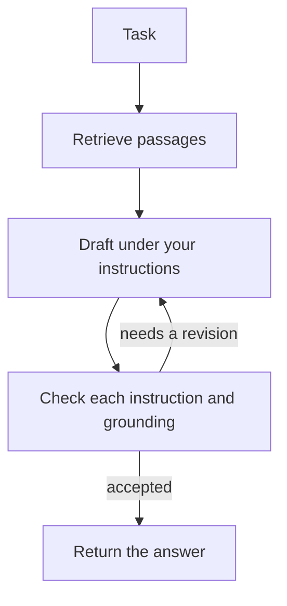

# loop-kit

loop-kit answers from your documents. You give it a knowledge base and, when you want to, instructions. It retrieves the relevant passages and runs a draft, check, and revise loop until the answer follows those instructions and stays inside the documents.

The model does not own the loop. Code does. loop-kit is a library. A program keeps a `Loop` and calls `ask`.

```python
from loopkit import Loop

loop = Loop(knowledge="knowledge")
print(loop.ask("What is the refund window?"))
```

Set one API key in the environment. If only one of these is set, that provider is used:

| Provider | Environment variable | Default model |
| --- | --- | --- |
| xAI | `XAI_API_KEY` | `grok-4.7` |
| OpenAI | `OPENAI_API_KEY` | `gpt-6.1-sol` |
| Anthropic | `ANTHROPIC_API_KEY` | `claude-sonnet-5-5` |

```bash
pip install -e .
export XAI_API_KEY="your_api_key"
# or: export OPENAI_API_KEY="your_api_key"
# or: export ANTHROPIC_API_KEY="your_api_key"
```

If more than one key is set, pass `provider` or set `LOOPKIT_PROVIDER` to `xai`, `openai`, or `anthropic`. Another OpenAI-compatible server needs `base_url` and `model`:

```python
Loop(knowledge="knowledge", base_url="http://localhost:11434/v1", model="llama3.1")
```

Keys are read from the environment, or from `api_key=`. Do not commit them.

Install from this repository. The PyPI project named `loopkit` (no hyphen) is unrelated control-systems software. This project is `loop-kit`. xAI calls go through the [xAI SDK](https://docs.x.ai/developers/quickstart). OpenAI uses the Responses API. Anthropic uses the Messages API.

## The loop



Each turn is two model calls. The drafter writes an answer and cites passage ids. The checker returns a verdict for every instruction, judged on its own, plus grounding. The loop stops when every instruction holds, the draft stays inside the passages, citations are real ids, and the checker does not ask for another pass. Otherwise it revises, up to 3 turns, and the next draft is told which instructions failed. An accepted answer is two calls. A revised one is two calls per turn.

You bring documents and instructions. Chunking, retrieval, prompts, the checker, citation checks, and the stop condition ship in this repo. The loop itself is `src/loopkit/loop.py`.

## Defaults

| | |
| --- | --- |
| Provider | The one API key that is set. `provider` or `LOOPKIT_PROVIDER` chooses when several are set |
| Model | That provider's default, unless you pass `model` or set `LOOPKIT_MODEL` |
| Instructions | Four separate rules: answer only from the passages, cite ids, say when the answer is missing, and stay concise |
| Turns | 3 |
| Retrieval | The whole knowledge base under about 16,000 characters; otherwise a local lexical index, top 8 passages |
| Stored prompts | Off for xAI and OpenAI. The request is still sent to the provider you configured |

No vector database, no embedding model, and no agent graph.

## Instructions

Instructions are a list. The checker judges each one on its own. The loop revises until every item holds, or the turn budget runs out. A miss is named in the notes for the next draft.

Pass them when the built-in policy is not the one you want:

```python
loop = Loop(
    knowledge="knowledge",
    instructions=[
        "You are the Sample Co support assistant.",
        "Answer in under 80 words.",
    ],
)
```

A string is split into one instruction per non-empty line, which is how an instructions file is read. `loop.instructions` is always the tuple the checker validates.

Or put the list in `loopkit.toml` and leave it out of code:

```toml
knowledge = "knowledge"
instructions = [
  "You are the Sample Co support assistant.",
  "Answer in under 80 words.",
]
```

The same `Loop` is what the terminal command calls. `loopkit ask` is a way to try a project without writing a script. It prints each step to stderr. `--quiet` prints the answer only. `--json` prints the answer object.

```bash
loopkit ask "Can I get a refund?"
```

## Use the answer

```python
answer = loop.ask("What is the refund window?")
answer.text
answer.citations   # passages the draft cited
answer.checks      # one auditor result per turn, with a verdict for each instruction
answer.turns
answer.stopped_reason  # "passed" or "max_turns"
```

`str(answer)` is the text. Build the `Loop` once and call `ask` for each task. Documents are read at construction.

`stopped_reason` is `"max_turns"` when the last check still wanted a revision. You still get the latest draft, and `answer.checks` says why it did not pass.

## Knowledge

```python
Loop(knowledge="docs/")
Loop(knowledge="handbook.md")
Loop(knowledge=["docs/", "faq.md"])
Loop(knowledge={"policy": "Refunds are available for 30 days."})
Loop(knowledge="Refunds are available for 30 days. After that the sale is final.")
```

A string is read from disk when that path exists. Any other string that contains whitespace is the document. A single word that is not a path raises an error, so a missing `docs` folder is not treated as the knowledge text.

Text files: `.md`, `.markdown`, `.txt`, `.rst`, `.json`, `.yaml`, `.yml`, `.toml`, `.csv`. Other files are skipped and reported. Hidden files, `.git`, and virtualenvs are skipped. A file over 1 MB is skipped.

Markdown headings become passage headings. Text inside fenced code blocks stays in the passage, including comment lines that start with `#`.

## Try a loop

`loopkit ask` and `loopkit serve` call the same `Loop` you use in code. They are for trying a knowledge base, not a second product. In an application, import `Loop` and call `ask`.

```bash
loopkit serve
```

Open http://127.0.0.1:8080. The page posts to `POST /ask` with `{"task": "..."}`. `GET /health` returns `{"ok": true}`. The process binds to `127.0.0.1` and has no authentication. Keep it off public networks.

## What the model is allowed to do

Passages are evidence. A document that says to ignore your instructions is not followed. The end user's task does not rewrite your instructions. A draft that cites a passage id the loop did not provide cannot pass the check.

Point loop-kit at documents you are willing to send to the API.

## Project file

`loopkit init` writes `loopkit.toml` and `knowledge/start.md`. Only `knowledge` is required.

```toml
knowledge = "knowledge"

# instructions = [
#   "You are the support assistant for this knowledge base.",
#   "Answer in under 120 words.",
# ]

# provider = "openai"
# model = "gpt-6.1-sol"
# base_url = "http://localhost:11434/v1"
# max_turns = 3
# top_k = 8
```

Paths in the file are relative to the file. Passing `knowledge=` to `Loop` skips the file. The API key is never read from this file.

Set `LOOPKIT_TRACE=1` to print loop steps. `LOOPKIT_MODEL` changes the model without code changes. `LOOPKIT_PROVIDER` chooses a provider when more than one key is set.

## Example

`examples/northwind` is a small support desk: billing and account notes, plus instructions.

```bash
export XAI_API_KEY="your_api_key"  # or OPENAI_API_KEY, or ANTHROPIC_API_KEY
python examples/northwind/ask.py
python examples/northwind/ask.py How do I rotate an API key?
```

## Develop

```bash
pip install -e ".[dev]"
pytest
```

Tests use a scripted model. They do not call the API.

## License

MIT.
