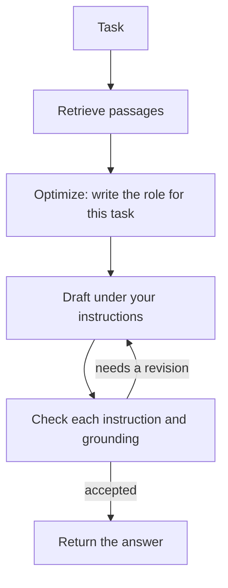

<h1 align="center">loop-kit</h1>

<p align="center">
  Answers from your documents, checked against your instructions.<br>
  A draft, check, and revise loop that code controls, not the model.
</p>

<p align="center">
  <a href="https://github.com/OWNER/loop-kit/actions/workflows/ci.yml"></a>
  <a href="https://pypi.org/project/loop-kit/"></a>
  
  
  <a href="LICENSE"></a>
</p>

---

loop-kit answers from your documents. You give it a knowledge base and, when you want to, instructions. It retrieves the relevant passages and runs a draft, check, and revise loop until the answer follows those instructions and stays inside the documents.

The model does not own the loop. Code does. loop-kit is a library. A program keeps a `Loop` and calls `ask`.

```python
from loopkit import Loop

loop = Loop(knowledge="knowledge")
print(loop.ask("What is the refund window?"))
```

## Contents

- [Why loop-kit](#why-loop-kit)
- [Install](#install)
- [Quickstart](#quickstart)
- [The loop](#the-loop)
- [Configuration](#configuration)
  - [Providers](#providers)
  - [A second model for the checks](#a-second-model-for-the-checks)
  - [Defaults](#defaults)
  - [Instructions](#instructions)
  - [Knowledge](#knowledge)
  - [Project file](#project-file)
- [Use the answer](#use-the-answer)
- [Command line](#command-line)
- [What the model is allowed to do](#what-the-model-is-allowed-to-do)
- [Token budget](#token-budget)
- [Response length](#response-length)
- [Output format](#output-format)
- [Example](#example)
- [Status](#status)
- [Develop](#develop)
- [Contributing](#contributing)
- [Citation](#citation)
- [License](#license)

## Why loop-kit

You point a model at your docs and it answers beautifully, and some of it is made up. You add "only answer from the documents" and "keep it under 80 words" to the prompt, and it follows them most of the time, which is the same as not following them. So you reach for the usual stack: an embedding model, a vector database, an agent framework, and a growing prompt nobody wants to touch. Weeks later the answers are still confident, still occasionally wrong, and now you cannot tell why.

loop-kit takes the opposite bet. Keep the model on a short leash and let code do the looping. The model drafts an answer and cites the passages it used. Then it is checked, one instruction at a time, so a miss cannot hide in a long list, and once more for grounding: did it stay inside the passages, are the citations real. If anything fails, the next draft is told exactly what to fix. If everything passes, you get the answer and the audit trail that proves it. Three turns, then it stops. There is no vector database to run, no embedding model to pick, no graph to debug. There is a folder of documents, a list of rules, and a loop you can read in one file.

## Install

```bash
pip install loop-kit            # OpenAI, Anthropic, and OpenAI-compatible servers
pip install "loop-kit[xai]"     # adds the xAI SDK for Grok
```

Requires Python 3.11 or newer. The PyPI project named `loopkit` (no hyphen) is unrelated control-systems software. This project is `loop-kit`.

To install from a checkout instead: `pip install -e .` (or `-e ".[xai]"`).

## Quickstart

Set one API key in the environment. If only one of these is set, that provider is used:

```bash
export XAI_API_KEY="your_api_key"
# or: export OPENAI_API_KEY="your_api_key"
# or: export ANTHROPIC_API_KEY="your_api_key"
```

Point a `Loop` at a folder of documents and ask:

```python
from loopkit import Loop

loop = Loop(
    knowledge="docs/",
    instructions=[
        "You are the Sample Co support assistant.",
        "Answer in under 80 words.",
    ],
)
answer = loop.ask("What is the refund window?")
print(answer)                 # the text
print(answer.citations)       # the passages it used
print(answer.stopped_reason)  # "passed", "max_turns", or "token_budget"
```

Or try it from the terminal without writing a script:

```bash
loopkit init                              # writes loopkit.toml and knowledge/start.md
loopkit ask "What is the refund window?"  # prints each loop step to stderr, the answer to stdout
```

From a checkout, `make` does the setup for you. The first call creates `.venv/` and installs everything; later calls reuse it:

```bash
cp .env.example .env                      # put one API key in it; .env is gitignored
make init                                 # or: make example
make ask Q="What is the refund window?"
make serve                                # http://127.0.0.1:8080
```

Keys are read from the environment, or from `api_key=`. Do not commit them.

## The loop



The optimize step is one call that writes who the model should be for this task (see [Auto-optimize](#auto-optimize)); that role prefixes every call after it. The drafter writes an answer and cites passage ids. By default the checker then judges one instruction per call, so a long list is not scored all at once, and finishes with one grounding check. The loop stops when every instruction holds, the draft stays inside the passages, citations are real ids, and the checker does not ask for another pass. Otherwise it revises, up to 3 turns, and the next draft is told which instructions failed. `check_mode="all"` is the two-call turn: one draft, then one check that scores every instruction together.

This is what `loopkit ask` prints while it runs (stderr), for the [example](#example) knowledge base with five instructions, when the first draft misses one:

```text
loopkit: 4 passages loaded, 4 sent to the model
loopkit: turn 1: draft
loopkit: turn 1: check instruction 1
loopkit: turn 1: check instruction 2
loopkit: turn 1: check instruction 3
loopkit: turn 1: check instruction 4
loopkit: turn 1: check instruction 5
loopkit: turn 1: check grounding
loopkit: instructions not followed: 2
loopkit: revise
loopkit: turn 2: draft
loopkit: turn 2: check instruction 1
loopkit: turn 2: check instruction 2
loopkit: turn 2: check instruction 3
loopkit: turn 2: check instruction 4
loopkit: turn 2: check instruction 5
loopkit: turn 2: check grounding
loopkit: stop: passed
Yes. Northwind refunds a subscription cancelled within 14 days of the charge, so a charge from 10 days ago qualifies. The refund returns to the original payment method within 5 business days. [p1]
```

You bring documents and instructions. Chunking, retrieval, prompts, the checker, citation checks, and the stop condition ship in this repo. The loop itself is [`src/loopkit/loop.py`](src/loopkit/loop.py).

## Configuration

### Providers

| Provider | Environment variable | Default model | Transport |
| --- | --- | --- | --- |
| xAI | `XAI_API_KEY` | `grok-4.7` | [xAI SDK](https://docs.x.ai/developers/quickstart), via the `xai` extra |
| OpenAI | `OPENAI_API_KEY` | `gpt-6.1-sol` | Responses API, standard library only |
| Anthropic | `ANTHROPIC_API_KEY` | `claude-sonnet-5-5` | Messages API, standard library only |
| OpenAI-compatible | `LOOPKIT_API_KEY`, or `OPENAI_API_KEY`; none for a local URL | none; pass `model` | Chat completions, standard library only |

If more than one key is set, pass `provider` or set `LOOPKIT_PROVIDER` to `xai`, `openai`, or `anthropic`. Another OpenAI-compatible server needs `base_url` and `model`:

```python
Loop(knowledge="knowledge", base_url="http://localhost:11434/v1", model="llama3.1")
```

Environment variables, all optional:

| Variable | Effect |
| --- | --- |
| `LOOPKIT_PROVIDER` | Chooses the provider when more than one key is set |
| `LOOPKIT_MODEL` | Overrides the model without code changes |
| `LOOPKIT_BASE_URL` | Same as `base_url=`; implies the OpenAI-compatible provider |
| `LOOPKIT_API_KEY` | Key for an OpenAI-compatible server. Falls back to `OPENAI_API_KEY`; `localhost` URLs need neither |
| `LOOPKIT_CHECK_MODEL` | A second model for the checks; see [A second model for the checks](#a-second-model-for-the-checks) |
| `LOOPKIT_CHECK_PROVIDER` | Its provider, when it is not the draft's |
| `LOOPKIT_CHECK_BASE_URL` | An OpenAI-compatible server for the checks |
| `LOOPKIT_TRACE` | `1` prints each loop step to stderr (`loopkit ask` does this by default) |
| `LOOPKIT_TOKEN_BUDGET` | A cap on the tokens one `ask` may spend; see [Token budget](#token-budget) |
| `LOOPKIT_TOKEN_BUDGET_MODE` | `soft` or `hard`: how that cap is held |
| `LOOPKIT_RESPONSE_LENGTH` | `auto` or a number of characters: hold each draft to a length; see [Response length](#response-length) |

### A second model for the checks

By default one model drafts and checks. `check_model` puts the checks on another: every instruction check, the combined check, and the grounding or accuracy audit. The optimize step and the drafts stay on `model`. Judging one instruction against one draft is a narrower job than writing the draft, so a smaller or cheaper model often does it well, and a model from another family judges with different blind spots.

```python
Loop(knowledge="knowledge", check_model="gpt-6.1-mini")                          # same provider as the drafts
Loop(knowledge="knowledge", check_provider="anthropic")                          # Anthropic's default model
Loop(knowledge="knowledge", check_provider="anthropic", check_model="claude-haiku-5")
Loop(knowledge="knowledge", check_base_url="http://localhost:11434/v1", check_model="llama3.1")
```

```bash
loopkit ask "What is the refund window?" --check-model gpt-6.1-mini
loopkit ask "What is the refund window?" --check-provider anthropic --check-model claude-haiku-5
LOOPKIT_CHECK_PROVIDER=anthropic LOOPKIT_CHECK_MODEL=claude-haiku-5 loopkit ask ...
```

or `check_model`, `check_provider`, and `check_base_url` in `loopkit.toml`. How they resolve:

| Set | The checks use |
| --- | --- |
| nothing | the same client as the drafts |
| `check_model` only | that model on the draft's provider, key, and server |
| `check_provider` | that provider, with its key from the environment (`check_api_key` in code to pass one) and its default model unless `check_model` says otherwise. `LOOPKIT_MODEL` is the draft's and does not apply |
| `check_base_url` | an OpenAI-compatible server; `check_model` is required because such a server has no default |
| `check_client` (code) | that object, like `client` |

With `search=True` the grounding audit searches, so the check provider needs a search tool: a `compatible` check server refuses it, as it does for the drafts. `loopkit ask` prints `models: openai gpt-6.1-sol drafts; anthropic claude-haiku-5 checks` when they differ, and the debug log names the provider and model on every `CALL`. One token budget covers both models.

### Defaults

| | |
| --- | --- |
| Provider | The one API key that is set. `provider` or `LOOPKIT_PROVIDER` chooses when several are set |
| Model | That provider's default, unless you pass `model` or set `LOOPKIT_MODEL` |
| Check model | The draft's. `check_model`, `check_provider`, or `check_base_url` puts the checks on another model or provider |
| Instructions | With passages, four separate rules: answer only from the passages, cite ids, say when the answer is missing, and stay concise. With no passages (open mode), three: answer from your own knowledge, flag uncertain specifics, stay concise |
| Check | `each`: one model call per instruction, then grounding. `all`: every instruction in one call |
| Response | `normal`. `book` asks for a long response and raises the output cap to 100,000 tokens |
| Turns | 3 |
| Token budget | None. `token_budget` or `LOOPKIT_TOKEN_BUDGET` caps the tokens one `ask` may spend across all of its calls; `token_budget_mode` is `soft` (a turn at a time) or `hard` (a call at a time) |
| Response length | Left to the instructions. `response_length="auto"` holds each draft to the length the estimate step expects; an integer holds it to that many characters |
| Output format | `text`. `output_format="json"` with `output_schema` holds each draft to one JSON document of that shape |
| Retrieval | The whole knowledge base under about 16,000 characters; otherwise a local RAG query (BM25), top 8 passages |
| Search | Off. `search=True` lets the model use the provider's web search in the draft and the audit |
| Auto-optimize | On. One call before the loop writes a role for the task that prefixes every draft and check. `auto_optimize=False` skips it |
| Stored prompts | Off for xAI and OpenAI. The request is still sent to the provider you configured |

### Instructions

Instructions are a list. The checker judges each one on its own. The loop revises until every item holds, or the turn budget runs out. A miss is named in the notes for the next draft.

Pass them when the built-in policy is not the one you want:

```python
loop = Loop(
    knowledge="knowledge",
    instructions=[
        "You are the Sample Co support assistant.",
        "Answer in under 80 words.",
    ],
)
```

A string is split into one instruction per non-empty line, which is how an instructions file is read. A list is used as given: each item is one instruction, and line breaks inside an item stay part of that instruction. `loop.instructions` is always the tuple the checker validates.

`check_mode="each"` validates those items one call at a time. `check_mode="all"` sends the whole list to one check. `response="book"` asks for a long-form answer with headings, instead of the concise default, and raises the output cap on the built-in clients. `response="normal"` is the direct answer.

Or put the list in `loopkit.toml` and leave it out of code:

```toml
knowledge = "knowledge"
instructions = [
  "You are the Sample Co support assistant.",
  "Answer in under 80 words.",
]
```

The same `Loop` is what the terminal command calls. `loopkit ask` is a way to try a project without writing a script. It prints each step to stderr. `--quiet` prints the answer only. `--json` prints the answer object.

```bash
loopkit ask "Can I get a refund?"
```

The task can also come from a file or from stdin, which sidesteps shell quoting:

```bash
loopkit ask --task-file question.txt
echo 'What does `ls -la` do?' | loopkit ask
cat question.md | loopkit ask -
```

Backticks are the usual trap. In bash and zsh, `` `ls` `` inside double quotes runs `ls` and pastes its output into the task; use single quotes, or `\``. In PowerShell the backtick is the escape character; write ``` `` ``` for a literal one, or use `--task-file`. None of this is loop-kit: the task is sent to the model exactly as the shell hands it over.

## Auto-optimize

On by default. Before the first draft, one extra model call reads the task, your instructions, and (with a knowledge base) the list of document names and headings, and writes a **role**: two to four sentences, second person, starting with "You are", naming the field, the sub-speciality, and the working habits that fit this particular task. That role is prefixed to the system prompt of every call that follows in that `ask`: the draft, each instruction check, and the grounding or accuracy audit. The optimizer is told not to answer the task and not to add rules about format, length, or sources; your numbered instructions still take precedence.

The point is that the model that answers, and the model that checks the answer, both work as the right specialist rather than as a generic assistant. The same `Loop` gets a different role for each task.

What it produces, by example:

| Task | Role the optimize step writes (illustrative) |
| --- | --- |
| *Explain Dhammapada verse 1 and the story attached to it* (no knowledge base) | You are a scholar of early Buddhist literature with a specialism in the Pali Dhammapada and its commentary. You separate what the verse says from what the later commentarial story adds, you mark translations as your own or name the translator, and you explain Pali terms on first use for a general reader. |
| *Can I get a refund? I was charged 10 days ago* (Northwind knowledge base) | You are a Northwind billing support specialist who knows the company's refund and plan policies from its own documentation. You answer with the exact window and conditions, and you say plainly when a case falls outside them. |
| *How do I rotate an API key?* (Northwind knowledge base) | You are a Northwind account-security support engineer who knows its API key lifecycle. You give steps in the order a user would perform them and you call out what cannot be undone. |

The role is returned as `answer.role` and in `--json`, printed as a `role:` trace line by `loopkit ask`, and written to the debug log as `CALL 1: optimize` with the full prompt and reply, then under `ROLE` in the `ANSWER` block. If the optimize call fails, a warning is logged and the loop continues with no role; a quality step does not by itself stop an answer.

Today the role is generated from the task, the instructions, and the document list. Later versions can feed it more context. Turn it off when you supply your own persona in the instructions and do not want a second one, or to save the call:

```python
Loop(knowledge="knowledge", auto_optimize=False)
```

```bash
loopkit ask "Can I get a refund?" --no-auto-optimize
LOOPKIT_AUTO_OPTIMIZE=0 loopkit ask ...
```

or `auto_optimize = false` in `loopkit.toml`. With it on, a default `ask` is 7 model calls per turn at most on the first turn (optimize, draft, 4 instruction checks, grounding), then 6 per revision turn; `check_mode="all"` makes that 3 then 2.

## Use the answer

```python
answer = loop.ask("What is the refund window?")
answer.text
answer.citations   # passages the draft cited
answer.role        # the role the optimize step wrote for this task, "" when off
answer.response    # "normal" or "book"
answer.checks      # one auditor result per turn, with a verdict for each instruction
answer.turns
answer.stopped_reason  # "passed", "max_turns", or "token_budget"
answer.tokens          # what the ask spent: input, output, total, calls, budget
answer.response_length # the characters each draft was held under, or None
answer.output_format   # "text" or "json"
answer.data            # the parsed JSON document with output_format="json", else None
```

`str(answer)` is the text. Build the `Loop` once and call `ask` for each task. Documents are read at construction.

`stopped_reason` is `"max_turns"` when the last check still wanted a revision, and `"token_budget"` when the [token budget](#token-budget) ran out first. You still get the latest draft, and `answer.checks` says why it did not pass.

## Knowledge

```python
Loop(knowledge="docs/")
Loop(knowledge="handbook.md")
Loop(knowledge=["docs/", "faq.md"])
Loop(knowledge={"policy": "Refunds are available for 30 days."})
Loop(knowledge="Refunds are available for 30 days. After that the sale is final.")
```

A string is read from disk when that path exists. Any other string that contains whitespace is the document. A single word that is not a path raises an error, so a missing `docs` folder is not treated as the knowledge text.

### Open mode: no knowledge base

No knowledge at all is allowed. `Loop()` with no `knowledge` and no `loopkit.toml`, a `loopkit.toml` that does not set `knowledge`, and `loopkit ask` without `--knowledge` all run in **open mode**: `loop.mode == "open"` and `answer.mode == "open"`. A `LoopWarning` is issued (the CLI prints it to stderr) so this is never silent. A path that is given but does not exist is still an error.

Open mode is not knowledge mode with an empty passage list. Everything that would make the model refuse is swapped out:

| | Knowledge mode | Open mode |
| --- | --- | --- |
| Drafter | Use passage facts only; cite `[pN]` | Answer the task fully and directly; flag uncertain specifics |
| Prompt | `PASSAGES:` block, `CITED IDS` in audits | Instructions, task, and draft only. Nothing sent to the model mentions passages, a knowledge base, or citations |
| Built-in instructions | `DEFAULT_INSTRUCTIONS` | `OPEN_INSTRUCTIONS` (or `OPEN_BOOK_INSTRUCTIONS` for `response="book"`) |
| Second audit | Grounding: every claim supported by a passage | Accuracy: no claim the checker believes is false, no invented names, dates, figures, or quotations presented as fact |
| Stray `[pN]` in a draft | "not in the passages" | "remove the bracketed reference markers" |

Your own `instructions=` are used as given in both modes. An instruction like "Use only the knowledge base" will still make the model stop short when there is no knowledge base; that is the instruction working.

Text files: `.md`, `.markdown`, `.txt`, `.rst`, `.json`, `.yaml`, `.yml`, `.toml`, `.csv`. Other files are skipped and reported. Hidden files, `.git`, and virtualenvs are skipped. A file over 1 MB is skipped.

Markdown headings become passage headings. Text inside fenced code blocks stays in the passage, including comment lines that start with `#`.

Documents are read when the `Loop` is built, not on every question. Build it once and call `ask` for each task.

### Project file

`loopkit.toml` is the settings for one knowledge base, kept out of code: where the documents are, the instructions, and the provider and loop options. It is read when you build a `Loop` without `knowledge=` (`Loop.load()`), call `loopkit.ask(task)` without knowledge, or run `loopkit ask` without `--knowledge`. It is optional: every setting can be passed in code or on the command line instead.

`loopkit init` writes it, plus `knowledge/start.md`, in the current directory. Run it where you want the project to live; it does not overwrite files that already exist.

```toml
knowledge = "knowledge"

# instructions = [
#   "You are the support assistant for this knowledge base.",
#   "Answer in under 120 words.",
# ]

# provider = "openai"
# model = "gpt-6.1-sol"
# base_url = "http://localhost:11434/v1"
# check_model = "gpt-6.1-mini"
# check_provider = "anthropic"
# check_base_url = "http://localhost:11434/v1"
# max_turns = 3
# top_k = 8
# check_mode = "each"
# response = "normal"
# search = true
# auto_optimize = false
# token_budget = 20000
# token_budget_mode = "soft"
# response_length = "auto"
# output_format = "json"
# output_schema = "schema.json"
```

Paths in the file are relative to the file. `Loop.load()` reads it; passing `knowledge=` to `Loop` skips the file. The API key is never read from this file, so it is safe to commit.

## Use the answer

```python
answer = loop.ask("What is the refund window?")
answer.text
answer.citations   # passages the draft cited
answer.response    # "normal" or "book"
answer.checks      # one auditor result per turn, with a verdict for each instruction
answer.turns
answer.stopped_reason  # "passed", "max_turns", or "token_budget"
answer.tokens      # what the ask spent: input, output, total, calls, budget
answer.to_dict()   # JSON-ready, the same shape `loopkit ask --json` prints
```

`str(answer)` is the text.

`stopped_reason` is `"max_turns"` when the last check still wanted a revision, and `"token_budget"` when the [token budget](#token-budget) ran out first. You still get the latest draft, and `answer.checks` says why it did not pass.

## Command line

`loopkit ask` and `loopkit serve` call the same `Loop` you use in code. They are for trying a knowledge base, not a second product. In an application, import `Loop` and call `ask`.

| Command | What it does |
| --- | --- |
| `loopkit init` | Writes `loopkit.toml` and `knowledge/start.md` in the current directory |
| `loopkit ask "question"` | Answers from the project file. `--quiet` prints the answer only; `--json` prints the answer object; `-k/--knowledge`, `-i/--instructions` (repeatable), `--instructions-file`, `--model`, `--provider`, `--base-url`, `--check-model`, `--check-provider`, `--check-base-url`, `--max-turns`, `--token-budget`, `--token-budget-mode`, `--response-length`, `--output-format`, `--output-schema`, `--check-mode`, `--response` override the file |
| `loopkit serve` | A local page that posts to `POST /ask` with `{"task": "..."}` and an optional `"token_budget"`. `GET /health` returns `{"ok": true}`. `--host`, `--port`, `--trace` |
| `loopkit --version` | Prints the installed version |

`loopkit serve` opens on http://127.0.0.1:8080. The process binds to `127.0.0.1` and has no authentication. Keep it off public networks.

## What the model is allowed to do

Set `LOOPKIT_TRACE=1` to print loop steps. `LOOPKIT_MODEL` changes the model without code changes. `LOOPKIT_PROVIDER` chooses a provider when more than one key is set. `LOOPKIT_BASE_URL` sets the server for the `compatible` provider.

## Token budget

A loop that drafts, checks every instruction, and revises up to three times can make twenty model calls for one question, each carrying the passages. `token_budget` caps what one `ask` may spend, input and output together, across all of those calls:

```python
loop = Loop(knowledge="knowledge", token_budget=20_000)
answer = loop.ask("What is the refund window?")
answer = loop.ask("Summarise the billing policy.", token_budget=5_000)  # this task only
print(answer.tokens.total, answer.tokens.budget, answer.stopped_reason)
```

```bash
loopkit ask "What is the refund window?" --token-budget 20000
loopkit ask "What is the refund window?" --token-budget 20000 --token-budget-mode hard
LOOPKIT_TOKEN_BUDGET=20000 LOOPKIT_TOKEN_BUDGET_MODE=hard loopkit ask ...
```

or `token_budget = 20000` and `token_budget_mode = "hard"` in `loopkit.toml`. `POST /ask` on `loopkit serve` takes `"token_budget"` in the body.

The budget is enforced in code, not by asking the model to be brief. Before a call the loop estimates what it will cost; after a call it counts what the provider reported in `usage` (the built-in xAI, OpenAI, Anthropic, and compatible clients all report it; a client that does not is counted from the prompt and reply text, and `answer.tokens.estimated` is true). A call is never cut short. When the budget runs out the loop stops and returns what it has with `stopped_reason="token_budget"`. How far ahead it looks, and what "what it has" is, depends on the mode:

| | `soft` (default) | `hard` |
| --- | --- | --- |
| Looks ahead | one whole turn: the draft and every check of it | one call |
| First draft | always made, even when the estimate says it will not fit | made only when the estimate says it fits |
| A turn that has started | runs to the end | stops at the first call that would not fit, and the moment the total is over |
| You get back | the latest fully checked draft | the draft as it stands, with the verdicts the check had reached; or no draft at all |
| Can overshoot by | up to one turn | at most the call that crossed the line |

Use `soft` when you want an answer that has been checked and are willing to go over by a turn. Use `hard` when the cap matters more than the checking. In hard mode a check that was cut part way keeps the verdicts it has; the instructions it did not reach have `followed=False` with the note `Not checked: the token budget ran out.`, `grounded` is false because grounding was not checked, and the check's `notes` name the step the budget stopped at. When even the first draft would not fit, `answer.text` is empty, `answer.turns` is `0`, and `loopkit ask` prints nothing to stdout and says why on stderr.

The optimize step is skipped in either mode when its call would not fit; a quality step never decides whether an answer comes back.

`loopkit ask` prints the budget, the first-draft estimate, and the spend to stderr. Hard mode, cut during the check:

```text
loopkit: token budget: 6,000 (hard); first draft reply estimated at 210 tokens
loopkit: turn 1: draft
loopkit: turn 1: check instruction 1
loopkit: turn 1: check instruction 2
loopkit: turn 1: check instruction 3
loopkit: turn 1: check instruction 4 skipped: token budget (5,250 of 6,000 tokens used)
loopkit: instructions not checked: 4
loopkit: stop: token budget
loopkit: tokens: 5,250 of 6,000 tokens used
```

`answer.tokens` is filled in whether or not a budget is set, so a run without one tells you what to set. The debug log records the tokens of every call under `RESULT`, and the estimate step under `ASK`.

### How a call is estimated

The cost of a call is its prompt plus its reply. The prompt exists, so it is counted with the token estimator and scaled by the ratio the provider has reported so far for this task (the passages are in every prompt, so the ratio settles after the first call). The reply does not exist yet, so it is sized by an **estimation strategy**, a deterministic rule set in [`src/loopkit/estimate.py`](src/loopkit/estimate.py) that the loop does not know the inside of. `EstimationStrategy` names the available rule sets; there is one:

- `EstimationStrategy.LAST_TURN`. At the start of every `ask` an estimate step sizes the task: the tokens of the question, the number of instructions, and the tokens of the passages that were retrieved. The **first** reply of each kind is sized from that alone: a concise draft as a share of the passages plus a share of the task, held between 120 and 1,500 tokens; a book-length draft as most of the passages, between 1,000 and 20,000; a per-instruction verdict at 100, the grounding audit at 200, the combined check at 80 plus 60 per instruction, the role at 120. Every **later** reply of a kind is assumed to be the size of the latest one of that kind the model actually produced: the second draft is expected to be as long as the first, the fifth instruction check as long as the fourth. Reported usage counts reasoning tokens as output, so with a reasoning model the first estimate is low and the second is right.

```python
from loopkit import EstimationStrategy, Loop

Loop(knowledge="knowledge", token_budget=20_000, estimation_strategy=EstimationStrategy.LAST_TURN)
```

The built-in token estimator, `loopkit.estimate_tokens`, needs no tokenizer package and lands within about a quarter of the provider's count for English prose. It is used for the prompt side of the estimate and for clients that report nothing, so the total is exact whenever the provider reports usage. For tighter estimates pass your own:

```python
import tiktoken

encoding = tiktoken.get_encoding("o200k_base")
loop = Loop(knowledge="knowledge", token_budget=20_000, token_estimator=lambda text: len(encoding.encode(text)))
```

Sizing the budget: one turn with the default four instructions is six calls (seven with the optimize step), and each call carries the passages. With 3,000 tokens of passages, a turn costs roughly 25,000 tokens on a provider that does not cache prompts, so a soft budget under that holds the loop to one turn and a hard budget under that stops part way through its check.

## Response length

"Answer in under 80 words" as an instruction is judged by the model, which does not count words. `response_length` holds the answer to a length in code:

```python
Loop(knowledge="knowledge", response_length=600)      # under 600 characters
Loop(knowledge="knowledge", response_length="auto")   # under what the estimate step expects
```

```bash
loopkit ask "What is the refund window?" --response-length 600
loopkit ask "What is the refund window?" --response-length auto
LOOPKIT_RESPONSE_LENGTH=auto loopkit ask ...
```

or `response_length = 600` (or `"auto"`) in `loopkit.toml`. It is off unless set; the instructions then decide the length as before.

How it works, with the same estimate step the [token budget](#token-budget) uses:

1. **A target.** `"auto"` takes the length the estimation strategy expects for the first draft of this task (see [How a call is estimated](#how-a-call-is-estimated)): for a concise answer, a share of the passages plus a share of the task, so a question over four short passages gets a few hundred characters and one over a long handbook gets more. An integer is used as given. Either way the target is held under what the model returns in one call (next point) and never below 200 characters.
2. **The model's maximum.** A model can only return so much in one call, and the loop does not yet stitch calls together, so the target is capped at the model's maximum response size. That size is assumed from the model name, in characters: about 128k output tokens for Grok and GPT models, 64k for Claude, and an 8k-token reply for any other name, which is what most OpenAI-compatible servers allow (`loopkit.estimate.MODEL_MAX_RESPONSE_CHARS`; a client's own output cap lowers it further). `loopkit ask` says so when an asked-for length was cut.
3. **The ask.** The drafter's system prompt gets one more rule: `RESPONSE LIMIT: keep the answer under 600 characters, about 100 words. Say what the task needs within that limit. Do not pad to reach it.` It sits with the other rules about how to answer rather than in the task, and it is the same on every turn. This is the soft part: the model is told, not cut off.
4. **The check, in code.** After each draft the loop measures `len(answer.text)` against the target, with a tenth of tolerance because models do not count characters. A draft over it is sent back with the note `The answer is 910 characters; keep it under 600 characters, about 100 words. Cut what the task does not need.` alongside any instruction misses, and the next draft is held to the same target. The result is in `answer.checks[n].length` (`limit`, `actual`, `followed`) and in `--json`; it is not an instruction and does not count toward `follows_instructions`. A draft still over it on the last turn comes back with `stopped_reason="max_turns"`, as any other miss would.
5. **The budget agrees.** With an explicit length the token meter expects the draft reply to be that long, so a budget and a length set together are consistent.

```text
loopkit: response length: under 360 characters, about 60 words
loopkit: turn 1: draft
loopkit: turn 1: response length 910 of 360 characters, over the limit
loopkit: turn 1: check instruction 1
...
loopkit: revise
loopkit: turn 2: draft
loopkit: turn 2: response length 77 of 360 characters, within the limit
```

**Not yet:** a response longer than one call. A target above the model's maximum is cut to the maximum, so a book-length answer on a small model is one call's worth. The plan is to draft such answers in parts, each under the maximum, and stitch them, with the checks run on the whole; it is tracked as `TODO(response-length)` in [`src/loopkit/estimate.py`](src/loopkit/estimate.py).

## Output format

By default the answer is prose. `output_format="json"` asks for one JSON document instead and holds it to a shape you give as `output_schema`:

```python
loop = Loop(
    knowledge="knowledge",
    output_schema={"refund_days": 0, "eligible": False, "steps": [""]},  # an example of the output
)
answer = loop.ask("Can I get a refund? I was charged 10 days ago")
answer.text   # '{"refund_days": 14, "eligible": true, "steps": ["Cancel in Billing"]}'
answer.data   # {'refund_days': 14, 'eligible': True, 'steps': ['Cancel in Billing']}
```

```bash
loopkit ask "Can I get a refund?" --output-schema '{"refund_days": 0, "eligible": false}'
loopkit ask "Can I get a refund?" --output-format json --output-schema schema.json
```

or in `loopkit.toml`, as a table or the path of a JSON file:

```toml
output_format = "json"
output_schema = "schema.json"

# or inline:
# [output_schema]
# refund_days = 0
# eligible = false
```

`output_schema` is either a **JSON Schema** (an object that uses `type`, `properties`, `items`, `enum`, `$ref`, ...) used as given, or an **example of the output**, from which a closed schema is inferred: every key in the example is required, no other key is allowed, and each value's type is the type in the example (`null` places no constraint). Giving a schema implies `output_format="json"`; `"json"` without one is an error. There are two formats, `text` and `json`.

What the loop does with it:

1. **The ask.** The drafter's system prompt gets the rule `OUTPUT FORMAT: json. The answer is one JSON document and nothing else ... It must follow the OUTPUT SCHEMA below exactly` and the schema itself. The checkers are told the draft is JSON by design, so its form is not a miss and citations may sit in the cited ids. With the built-in instructions, "cite inline as [p1]" becomes "name every passage you used by id in cited_ids", so markers do not land inside your data; `answer.citations` is filled from those ids as before.
2. **The check, in code.** After each draft the answer is parsed (a code fence around it is forgiven, prose around it is not) and validated against the schema by a small validator in [`src/loopkit/structure.py`](src/loopkit/structure.py). It covers the part of JSON Schema that describes a shape: `type`, `enum`, `const`, `properties`, `required`, `additionalProperties`, `items`, `minItems`/`maxItems`, `minLength`/`maxLength`, `minimum`/`maximum`, `anyOf`, and `$ref` into `$defs`; keywords it does not know are ignored. A draft that is not the document the schema asks for goes back with every problem, by path:

   ```text
   The answer must be one JSON document that follows the OUTPUT SCHEMA, with nothing outside it. Problems:
   - $.refund_days: expected integer, got string
   - $.method: this key is not in the schema
   ```

   The result is `answer.checks[n].structure` (`followed`, `problems`), also in `--json`. Like the length check it is not an instruction and does not count toward `follows_instructions`. A draft still off the schema on the last turn comes back with `stopped_reason="max_turns"`; `answer.data` is then the parsed document if it parsed, or `None`.
3. **The answer.** `answer.text` is the document, `answer.data` is it parsed, `answer.output_format` is `"json"`. `loopkit ask` prints the document; `--json` wraps it in the answer object with `data` as a nested value.

```text
loopkit: turn 1: output does not follow the schema: 2 problems
...
loopkit: revise
loopkit: turn 2: draft
loopkit: turn 2: output follows the schema
```

`response_length` and `output_format="json"` combine: the length is measured on the document's text.

## Web search

```python
Loop(knowledge="knowledge", search=True)
Loop(search=True)                          # open mode with search
```

```bash
loopkit ask "What changed in the 2025 rules?" --search
LOOPKIT_SEARCH=1 loopkit ask ...
```

or `search = true` in `loopkit.toml`. The provider runs the search and the model reads the results before it answers: OpenAI's `web_search` tool on the Responses API, Anthropic's `web_search_20250305` server tool (up to 5 searches per call), and the xAI SDK's `web_search()` tool. Search is attached to the draft calls and to the grounding or accuracy audit, not to the per-instruction checks. The `compatible` provider has no search tool and refuses `search=True`.

With passages, the built-in instructions become `SEARCH_INSTRUCTIONS`: passages first, search only for what they do not cover, and name the web source for those facts. In open mode the drafter is told to search when it is unsure and to name the source. Search results are not passages: they are not chunked, do not get `[pN]` ids, and do not appear in `answer.citations`; the source names live in the answer text. Search is billed by the provider in addition to tokens.

## Debug log

To see what the model was actually asked and what it actually said, at every step including the audits, turn on the debug log:

```bash
loopkit ask "Can I get a refund?" --debug              # appends to ./loopkit-debug.log
loopkit ask "Can I get a refund?" --debug runs/one.log
LOOPKIT_DEBUG=runs/one.log python examples/northwind/ask.py
```

```python
Loop(knowledge="knowledge", debug="runs/one.log")   # or debug=True for the default file
```

Each `ask` writes a sequence of ruled blocks:

| Block | Sections |
| --- | --- |
| `ASK` | the mode, the task, the numbered instructions, the passages that were retrieved and why |
| `CALL n: <stage>` | `SYSTEM PROMPT`, `USER PROMPT`, one per model call: `optimize`, `draft (turn 1)`, `check instruction 2 (turn 1)`, `check grounding (turn 1)`, ... |
| `RESULT n: <stage> -> ok/error` | `REQUEST PARAMETERS`, `RAW MODEL TEXT`, `RAW RESPONSE BODY`, then `PARSED` or `ERROR`; the tokens of the call and the running total are in the header |
| `TURN t DECISION: passed/revise/max_turns/token_budget` | the draft, one verdict per instruction with its note, the grounding result, and the exact revision notes sent to the next draft |
| `ANSWER` | the role, the final text and citations, the stop reason, the number of model calls, and the tokens spent |

Retries are logged too. Prompts and raw replies contain your documents, so treat the file like the documents. It is in `.gitignore`.

The log is the standard `logging` logger named `loopkit`, so a program can attach its own handler instead; blocks are emitted at `DEBUG`, retries at `WARNING`.

## Retries

A call that fails with HTTP 429, 529, 408, or a 5xx, or whose connection drops mid-request, is retried with exponential backoff and jitter: up to 4 retries, starting at about a second, capped at 30 seconds, honoring `Retry-After` when the provider sends one. The same policy covers the xAI SDK's gRPC errors (`RESOURCE_EXHAUSTED`, `UNAVAILABLE`, `INTERNAL`, `ABORTED`, `DEADLINE_EXCEEDED`). A 4xx other than 408 and 429, such as a bad key or an unknown model, is not retried. `LOOPKIT_MAX_RETRIES` changes the budget; `0` turns retries off. Each retry prints a warning to stderr from the CLI and goes to the debug log.

## Example

[`examples/northwind`](examples/northwind) is a small support desk: billing and account notes, plus instructions.

```bash
export XAI_API_KEY="your_api_key"  # or OPENAI_API_KEY, or ANTHROPIC_API_KEY
python examples/northwind/ask.py
python examples/northwind/ask.py How do I rotate an API key?
```

## Status

loop-kit is pre-1.0 (`0.x`). The public API is what `loopkit.__all__` exports. Minor releases may change it; every change is listed in [CHANGELOG.md](CHANGELOG.md) with a note when it breaks something. Once the API has settled, `1.0` will freeze it under semantic versioning.

Out of scope by design: a vector database or embedding model, an agent graph, and a hosted service. If you need those, loop-kit is probably the wrong tool; if you think one of them belongs here, open a discussion first.

## Develop

```bash
git clone https://github.com/OWNER/loop-kit.git
cd loop-kit
make check          # creates .venv, installs, then runs ruff, mypy, and pytest
make help           # every target: ask, serve, example, fmt, test, cov, build, ...
```

Without `make`: `pip install -e ".[dev]"`, `pre-commit install`, `pytest`.

Tests use a scripted model. They do not call the API. `ruff`, `mypy --strict`, and `pytest` run on every pull request for Python 3.11 to 3.13 on Linux, macOS, and Windows.

## Contributing

Bug reports, fixes, providers, and documentation are welcome. Please read [CONTRIBUTING.md](CONTRIBUTING.md) first; it covers the checks, the test rules, and what is in scope. Questions go to [Discussions](https://github.com/OWNER/loop-kit/discussions). Security reports go through [SECURITY.md](SECURITY.md), not the issue tracker.

This project follows the [Contributor Covenant](CODE_OF_CONDUCT.md).

## Citation

If loop-kit is useful in your research, cite it with the metadata in [`CITATION.cff`](CITATION.cff), or use the "Cite this repository" button on GitHub.

## License

[MIT](LICENSE).
